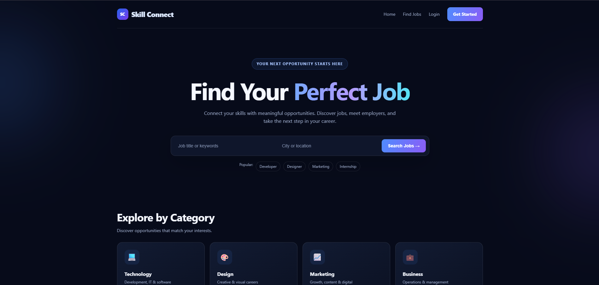
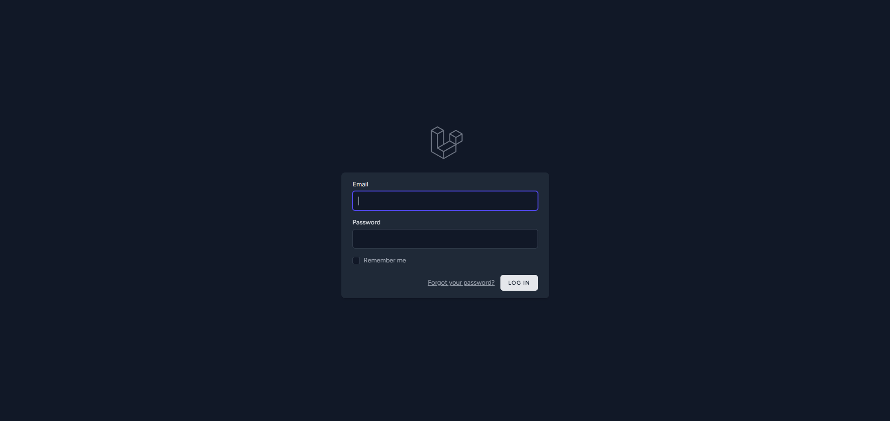
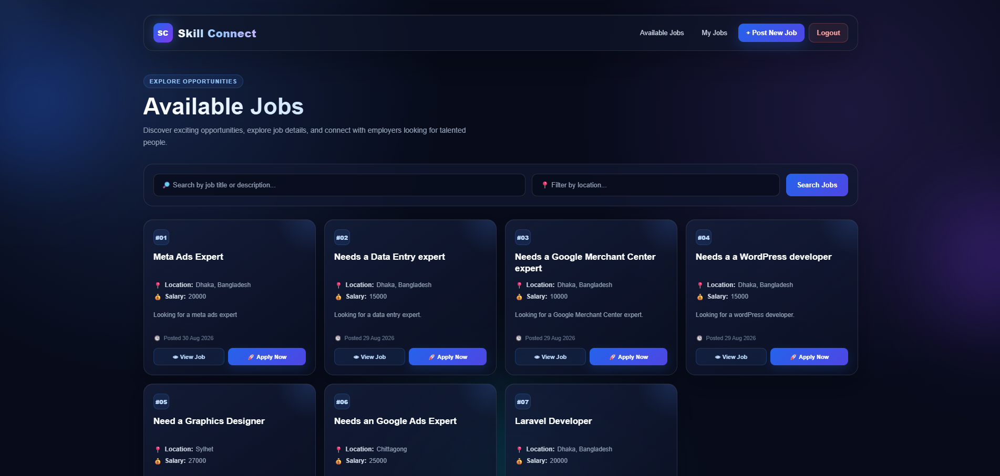
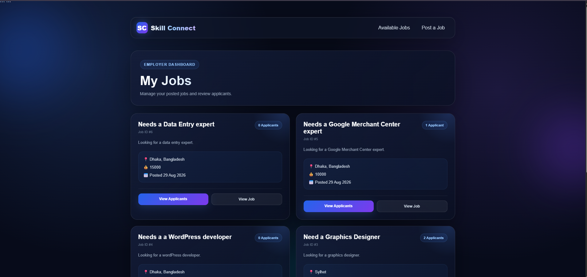

# **Skill Connect – Job Marketplace Platform**

# 

# **A web-based job marketplace platform built with Laravel that connects employers with skilled workers. Employers can post jobs, review applications, and manage applicants, while workers can explore opportunities and apply for suitable jobs.**

# 

# **Project Overview**

# 

# **Skill Connect is designed to make the hiring process easier by providing a platform where employers and job seekers can interact through a simple and organized system.**

# 

# **Key Features**

# 

# **Authentication \& User Management**

# **- User Registration and Login**

# **- Employer and Worker Roles**

# **- User Profile Management**

# **- Profile Editing**

# 

# **Job Management**

# **- Post New Jobs**

# **- Browse Available Jobs**

# **- View Job Details**

# **- Employer Job Management**

# 

# **Application Management**

# **- Apply for Jobs**

# **- Submit Cover Letters and Contact Information**

# **- Prevent Duplicate Applications**

# **- View My Applications**

# **- Employer Applicant Dashboard**

# **- Accept or Reject Applications**

# **- Application Status Tracking (Pending, Accepted, Rejected)**

# 

# **Technology Stack**

# 

# **| Category | Technologies |**

# **|---|---|**

# **| Backend | PHP, Laravel 12 |**

# **| Frontend | HTML, CSS, JavaScript, Blade |**

# **| Database | MySQL |**

# **| Authentication | Laravel Breeze |**

# **| Styling | Bootstrap / CSS |**

# **| Development Tools | Composer, NPM, Vite, XAMPP |**

# **| Version Control | Git \& GitHub |**

# 

# **Project Architecture**

# 

# **The project follows the Laravel MVC (Model-View-Controller) architecture.**

# 

# **- \*\*Model:\*\* Handles database operations and relationships.**

# **- \*\*View:\*\* Displays the user interface using Blade templates.**

# **- \*\*Controller:\*\* Handles application logic and user requests.**

# 

# **Installation \& Setup**

# 

# **Follow these steps to run Skill Connect locally.**

# 

# **Prerequisites**

# **- PHP 8.2 or later**

# **- Composer**

# **- Node.js and NPM**

# **- MySQL**

# **- XAMPP (or another local development environment)**

# 

# **1. Clone the Repository**

# 

# **bash**

# **git clone https://github.com/misha-akter/skill-connect.git**

# **cd skill-connect**

# 

# **2. Install Dependencies**

# 

# **bash**

# **composer install**

# **npm install**

# 

# **3. Configure Environment**

# 

# **bash**

# **copy .env.example .env**

# 

# **Update the database configuration in `.env`:**

# 

# **env**

# **DB\_CONNECTION=mysql**

# **DB\_HOST=127.0.0.1**

# **DB\_PORT=3306**

# **DB\_DATABASE=skill\_connect**

# **DB\_USERNAME=root**

# **DB\_PASSWORD=**

# 

# 

# **Create a MySQL database named `skill\_connect` using phpMyAdmin.**

# 

# **### 4. Generate Application Key**

# 

# **bash**

# **php artisan key:generate**

# 

# **5. Run Database Migrations**

# 

# **bash**

# **php artisan migrate**

# 

# **6. Build Frontend Assets**

# 

# **bash**

# **npm run build**

# 

# **7. Start the Development Server**

# 

# **bash**

# **php artisan serve**

# 

# **Open the application in your browser:**

# 

# **http://127.0.0.1:8000**

# 

# **Project Goals**

# 

# **- Simplify the job application process.**

# **- Connect employers with skilled workers.**

# **- Provide an organized job and application management system.**

# **- Demonstrate practical Laravel MVC development skills.**

# 

# **Future Improvements**

# 

# **- Advanced Job Search and Filtering**

# **- Email Notifications**

# **- Enhanced Admin Dashboard**

# **- Improved User Experience**

# **- Deployment to a Live Server**

# 

# **Developer**

# 

# **Misha Akter**

# 

# **GitHub: https://github.com/misha-akter**

# 

# **License**

# 

# **This project is developed for educational and portfolio purposes.**

## Screenshots

### Homepage

  

  <em>Skill Connect - Job Marketplace Homepage</em>

## Screenshots

  
   
  <em>Homepage</em>

  
   
  <em>Login Page</em>

  
   
  <em>Dashboard</em>

  
   
  <em>Job Details</em>

  
   
  <em>Applicants Page</em>

## Screenshots

  
   
  <em>Homepage</em>

  
   
  <em>Login Page</em>

  
   
  <em>Dashboard</em>

  
   
  <em>Job Details</em>

  
   
  <em>Applicants Page</em>

